# 05 - Database Schema & Entity-Relationship Diagram (ERD)
**Database Engine:** Microsoft SQL Server 2022  
**Project Name:** AlMomiaa Enterprise ERP & DMS  
**Version:** 3.1 (Complete Synchronized Schema — includes MR-01..MR-05, RISK-01..RISK-02, Double-Entry Ledger & Outbox)

---

## 1. Complete Entity-Relationship Diagram (Mermaid)

```mermaid
erDiagram
    USERS ||--o{ USER_ROLES : has_role
    ROLES ||--o{ ROLE_PERMISSIONS : has_permission
    USERS ||--o| FINANCIAL_ACCOUNTS : rep_custody_wallet
    USERS ||--o{ WAREHOUSES : assigned_mobile_van

    CUSTOMER_GRADES ||--o{ CUSTOMERS : sets_payment_terms
    PRICE_LISTS ||--o{ CUSTOMERS : assigns_tier
    USERS ||--o{ CUSTOMERS : assigned_to_rep

    CATEGORIES ||--o{ CATEGORIES : subcategories
    CATEGORIES ||--o{ MASTER_PRODUCTS : contains
    BRANDS ||--o{ MASTER_PRODUCTS : brands
    MASTER_PRODUCTS ||--o{ PRODUCT_UNITS : uom_conversions
    PRICE_LISTS ||--o{ PRICE_LIST_ITEMS : tier_prices
    PRODUCT_UNITS ||--o{ PRICE_LIST_ITEMS : priced_unit
    MASTER_PRODUCTS ||--o{ SUPPLIER_PRODUCTS : multi_supplier_map
    SUPPLIERS ||--o{ SUPPLIER_PRODUCTS : offers

    WAREHOUSES ||--o{ WAREHOUSE_STOCKS : holds_inventory
    MASTER_PRODUCTS ||--o{ WAREHOUSE_STOCKS : tracked_in
    WAREHOUSES ||--o{ STOCK_MOVEMENTS : audit_trail
    WAREHOUSES ||--o{ STOCK_TRANSFERS : transfers
    STOCK_TRANSFERS ||--o{ STOCK_TRANSFER_ITEMS : transfer_lines

    SUPPLIERS ||--o{ PURCHASE_ORDERS : receives_po
    PURCHASE_ORDERS ||--o{ PURCHASE_ORDER_ITEMS : po_lines
    PURCHASE_ORDERS ||--o{ CONTAINERS : container_tracking
    CONTAINERS ||--o{ GOODS_RECEIPTS : grn_receipt
    GOODS_RECEIPTS ||--o{ GOODS_RECEIPT_ITEMS : grn_lines

    CUSTOMERS ||--o{ SALES_ORDERS : places_order
    USERS ||--o{ SALES_ORDERS : submitted_by_rep
    WAREHOUSES ||--o{ SALES_ORDERS : fulfilled_from
    SALES_ORDERS ||--o{ SALES_ORDER_ITEMS : order_lines
    PRODUCT_UNITS ||--o{ SALES_ORDER_ITEMS : sold_in_unit
    SALES_ORDERS ||--o| INVOICES : generates_invoice
    ZATCA_DEVICE_SEQUENCES ||--o{ INVOICES : hash_chain_icv
    INVOICES ||--o{ SALES_RETURNS : credit_notes
    SALES_RETURNS ||--o{ SALES_RETURN_ITEMS : return_lines
    DELIVERY_DISPATCHES ||--o{ DELIVERY_DISPATCH_ITEMS : delivery_manifest
    INVOICES ||--o{ DELIVERY_DISPATCH_ITEMS : dispatched_invoice

    CUSTOMERS ||--o{ COLLECTIONS : makes_payment
    USERS ||--o{ COLLECTIONS : collected_by_rep
    COLLECTIONS ||--o{ COLLECTION_ALLOCATIONS : allocates_to
    INVOICES ||--o{ COLLECTION_ALLOCATIONS : settled_by
    FISCAL_PERIODS ||--o{ JOURNAL_ENTRIES : period_lock
    JOURNAL_ENTRIES ||--o{ JOURNAL_LINES : double_entry
    FINANCIAL_ACCOUNTS ||--o{ JOURNAL_LINES : ledger_posting
```



---

## 2. Synchronized SQL Server 2022 DDL Scripts

### 2.1 Schemas
```sql
CREATE SCHEMA [id];    -- Identity & Access Control
CREATE SCHEMA [cust];  -- Customers & Credit Grades
CREATE SCHEMA [cat];   -- Product Hierarchy, UOMs, Price Lists & Multi-Supplier Catalog
CREATE SCHEMA [inv];   -- Multi-Warehouse Stocks (including Mobile Vans), Movements & Transfers
CREATE SCHEMA [proc];  -- Suppliers, Purchase Orders, Containers & Goods Receipts
CREATE SCHEMA [sales]; -- Sales Orders, ZATCA Invoices, Sequence Lock, Returns & Delivery Dispatches
CREATE SCHEMA [fin];   -- Financial Accounts, Collections, Allocations, Fiscal Periods, Ledger & Snapshots
CREATE SCHEMA [ops];   -- Audit Logs, Outbox Messages & GPS Telemetry (replaces reserved SQL Server [sys] schema)
GO
```

### 2.2 Identity & Access Schema (`[id]`)
```sql
CREATE TABLE [id].[Users] (
    Id UNIQUEIDENTIFIER PRIMARY KEY,                         -- UUIDv7
    EmployeeCode NVARCHAR(30) NOT NULL UNIQUE,
    FullNameAr NVARCHAR(150) NOT NULL,
    FullNameEn NVARCHAR(150) NULL,
    Phone NVARCHAR(20) NOT NULL UNIQUE,
    Email NVARCHAR(150) NULL,
    PasswordHash NVARCHAR(500) NOT NULL,
    RepType NVARCHAR(20) NULL,                               -- NULL, 'Wholesale', 'Retail', 'CashVan'
    DefaultWarehouseId INT NULL,
    SecurityStamp UNIQUEIDENTIFIER NOT NULL,                 -- Checked in Redis for instant revocation
    IsActive BIT NOT NULL DEFAULT 1,
    CreatedAtUtc DATETIME2 NOT NULL DEFAULT SYSUTCDATETIME()
);

CREATE TABLE [id].[Roles] (
    Id INT IDENTITY(1,1) PRIMARY KEY,
    RoleCode NVARCHAR(30) NOT NULL UNIQUE,                   -- 'SUPER_ADMIN','EXEC_MGR','SALES_MGR','SALES_REP','ACCOUNTANT','WH_KEEPER','PURCH_MGR'
    NameAr NVARCHAR(100) NOT NULL,
    NameEn NVARCHAR(100) NOT NULL
);

CREATE TABLE [id].[RolePermissions] (
    RoleId INT NOT NULL REFERENCES [id].[Roles](Id),
    PermissionClaim NVARCHAR(100) NOT NULL,                  -- e.g., 'orders:edit_submitted', 'orders:coapprove_credit', 'finance:verify_bank'
    CONSTRAINT PK_RolePermissions PRIMARY KEY (RoleId, PermissionClaim)
);

CREATE TABLE [id].[UserRoles] (
    UserId UNIQUEIDENTIFIER NOT NULL REFERENCES [id].[Users](Id),
    RoleId INT NOT NULL REFERENCES [id].[Roles](Id),
    CONSTRAINT PK_UserRoles PRIMARY KEY (UserId, RoleId)
);

CREATE TABLE [id].[UserWarehouses] (
    UserId UNIQUEIDENTIFIER NOT NULL REFERENCES [id].[Users](Id),
    WarehouseId INT NOT NULL,                                -- Scopes WH_KEEPER / CashVan ABAC filter
    CONSTRAINT PK_UserWarehouses PRIMARY KEY (UserId, WarehouseId)
);

CREATE TABLE [id].[RefreshTokenSessions] (
    Id UNIQUEIDENTIFIER PRIMARY KEY,                         -- UUIDv7
    UserId UNIQUEIDENTIFIER NOT NULL REFERENCES [id].[Users](Id) ON DELETE CASCADE,
    FamilyId UNIQUEIDENTIFIER NOT NULL,                      -- Session rotation family identifier
    TokenHash VARCHAR(64) NOT NULL,                          -- Lowercase SHA-256 hex hash of opaque refresh token
    IssuedAtUtc DATETIME2 NOT NULL,
    ExpiresAtUtc DATETIME2 NOT NULL,                         -- Enforced <= IssuedAtUtc + 14 days
    RevokedAtUtc DATETIME2 NULL,
    ReplacedBySessionId UNIQUEIDENTIFIER NULL,               -- Rotation chain link
    RevocationReason NVARCHAR(100) NULL,
    RowVersion ROWVERSION NOT NULL,                          -- Optimistic concurrency for atomic rotation/revocation
    CONSTRAINT UX_RefreshTokenSessions_TokenHash UNIQUE (TokenHash),
    INDEX IX_RefreshTokenSessions_FamilyId (FamilyId),
    INDEX IX_RefreshTokenSessions_User_Active (UserId, RevokedAtUtc, ExpiresAtUtc)
);
```

### 2.3 Product Catalog, Price Lists & Multi-Supplier Schema (`[cat]`)
```sql
CREATE TABLE [cat].[Categories] (
    Id INT IDENTITY(1,1) PRIMARY KEY,
    ParentCategoryId INT NULL REFERENCES [cat].[Categories](Id),
    NameAr NVARCHAR(150) NOT NULL,
    NameEn NVARCHAR(150) NULL,
    DisplayOrder INT NOT NULL DEFAULT 0,
    IsActive BIT NOT NULL DEFAULT 1
);

CREATE TABLE [cat].[Brands] (
    Id INT IDENTITY(1,1) PRIMARY KEY,
    NameAr NVARCHAR(100) NOT NULL,
    NameEn NVARCHAR(100) NULL,
    IsActive BIT NOT NULL DEFAULT 1
);

CREATE TABLE [cat].[MasterProducts] (
    Id UNIQUEIDENTIFIER PRIMARY KEY,                         -- UUIDv7
    SKU NVARCHAR(50) NOT NULL UNIQUE,
    Barcode NVARCHAR(50) NOT NULL UNIQUE,
    NameAr NVARCHAR(250) NOT NULL,
    NameEn NVARCHAR(250) NULL,
    CategoryId INT NOT NULL REFERENCES [cat].[Categories](Id),
    BrandId INT NOT NULL REFERENCES [cat].[Brands](Id),
    BaseUnit NVARCHAR(30) NOT NULL,                          -- e.g., 'Carton', 'Piece'
    WeightedAvgCost DECIMAL(18,4) NOT NULL DEFAULT 0.0000,
    WholesaleSellingPrice DECIMAL(18,2) NOT NULL,
    RetailSellingPrice DECIMAL(18,2) NOT NULL,
    MinAllowedSellingPrice DECIMAL(18,2) NOT NULL,           -- MR-02 Price Floor
    VatRate DECIMAL(5,2) NOT NULL DEFAULT 15.00,
    IsActive BIT NOT NULL DEFAULT 1,
    RowVersion ROWVERSION NOT NULL,
    INDEX IX_MasterProducts_Category (CategoryId) INCLUDE (SKU, NameAr, WholesaleSellingPrice, RetailSellingPrice, MinAllowedSellingPrice)
);

CREATE TABLE [cat].[ProductUnits] (
    Id UNIQUEIDENTIFIER PRIMARY KEY,                         -- UUIDv7
    MasterProductId UNIQUEIDENTIFIER NOT NULL REFERENCES [cat].[MasterProducts](Id),
    UnitNameAr NVARCHAR(50) NOT NULL,
    UnitNameEn NVARCHAR(50) NOT NULL,
    ConversionFactor DECIMAL(18,4) NOT NULL DEFAULT 1.0000,
    Barcode NVARCHAR(50) NOT NULL UNIQUE,
    WholesalePrice DECIMAL(18,2) NOT NULL,
    RetailPrice DECIMAL(18,2) NOT NULL,
    MinAllowedPrice DECIMAL(18,2) NOT NULL,                  -- MR-02 Unit-level floor
    IsDefaultUnit BIT NOT NULL DEFAULT 1
);

-- MR-02: Dynamic Tiered Price Lists (Wholesale, Retail, KeyAccount)
CREATE TABLE [cat].[PriceLists] (
    Id INT IDENTITY(1,1) PRIMARY KEY,
    PriceListCode NVARCHAR(30) NOT NULL UNIQUE,              -- 'WHOLESALE', 'RETAIL', 'KEY_ACCOUNT'
    NameAr NVARCHAR(150) NOT NULL,
    NameEn NVARCHAR(150) NULL,
    IsDefault BIT NOT NULL DEFAULT 0,
    IsActive BIT NOT NULL DEFAULT 1,
    EffectiveFromUtc DATETIME2 NOT NULL DEFAULT SYSUTCDATETIME(),
    EffectiveToUtc DATETIME2 NULL
);

CREATE TABLE [cat].[PriceListItems] (
    Id UNIQUEIDENTIFIER PRIMARY KEY,
    PriceListId INT NOT NULL REFERENCES [cat].[PriceLists](Id),
    ProductUnitId UNIQUEIDENTIFIER NOT NULL REFERENCES [cat].[ProductUnits](Id),
    MinQuantity DECIMAL(18,3) NOT NULL DEFAULT 1.000,        -- Volume tier threshold (e.g., 500 cartons)
    TierUnitPrice DECIMAL(18,2) NOT NULL,
    CONSTRAINT UQ_PriceList_Unit_MinQty UNIQUE (PriceListId, ProductUnitId, MinQuantity)
);

CREATE TABLE [cat].[SupplierProducts] (
    Id UNIQUEIDENTIFIER PRIMARY KEY,
    MasterProductId UNIQUEIDENTIFIER NOT NULL REFERENCES [cat].[MasterProducts](Id),
    SupplierId UNIQUEIDENTIFIER NOT NULL,                    -- FK added after [proc].[Suppliers]
    SupplierSku NVARCHAR(50) NULL,
    SupplierBarcode NVARCHAR(50) NULL,
    LastPurchasePrice DECIMAL(18,4) NOT NULL,
    LeadTimeDays INT NULL,
    IsPreferredSupplier BIT NOT NULL DEFAULT 0,
    UpdatedAtUtc DATETIME2 NOT NULL DEFAULT SYSUTCDATETIME(),
    CONSTRAINT UQ_Supplier_MasterProduct UNIQUE (SupplierId, MasterProductId)
);
```

### 2.4 Customers & Configurable Grades Schema (`[cust]`)
```sql
CREATE TABLE [cust].[CustomerGrades] (
    Id INT IDENTITY(1,1) PRIMARY KEY,
    GradeCode CHAR(1) NOT NULL UNIQUE,                       -- 'A', 'B', 'C', 'D'
    DefaultPaymentDays INT NOT NULL,                         -- A=60, B=45, C=30, D=0
    AllowCredit BIT NOT NULL DEFAULT 1,
    UpdatedAtUtc DATETIME2 NOT NULL DEFAULT SYSUTCDATETIME()
);

CREATE TABLE [cust].[Customers] (
    Id UNIQUEIDENTIFIER PRIMARY KEY,                         -- UUIDv7
    CustomerCode NVARCHAR(30) NOT NULL UNIQUE,
    NameAr NVARCHAR(200) NOT NULL,
    NameEn NVARCHAR(200) NULL,
    Phone NVARCHAR(20) NOT NULL,
    Address NVARCHAR(500) NOT NULL,
    City NVARCHAR(100) NOT NULL DEFAULT N'Riyadh',
    Category NVARCHAR(50) NOT NULL,                          -- 'Market','Store','Restaurant','Supermarket','Wholesale'
    VatNumber NVARCHAR(15) NULL,
    GradeId INT NOT NULL REFERENCES [cust].[CustomerGrades](Id),
    PriceListId INT NULL REFERENCES [cat].[PriceLists](Id),  -- MR-02 Customer price tier
    CustomPaymentDays INT NULL,
    CreditLimit DECIMAL(18,2) NOT NULL DEFAULT 0.00,
    CurrentBalance DECIMAL(18,2) NOT NULL DEFAULT 0.00,
    AssignedRepId UNIQUEIDENTIFIER NOT NULL REFERENCES [id].[Users](Id),
    Latitude DECIMAL(9,6) NULL,
    Longitude DECIMAL(9,6) NULL,
    IsActive BIT NOT NULL DEFAULT 1,
    RowVersion ROWVERSION NOT NULL,
    INDEX IX_Customers_AssignedRep (AssignedRepId) INCLUDE (NameAr, GradeId, PriceListId, CreditLimit, CurrentBalance)
);
```

### 2.5 Multi-Warehouse, Mobile Vans & Real-Time Inventory Schema (`[inv]`)
```sql
CREATE TABLE [inv].[Warehouses] (
    Id INT IDENTITY(1,1) PRIMARY KEY,
    WarehouseCode NVARCHAR(20) NOT NULL UNIQUE,
    NameAr NVARCHAR(150) NOT NULL,
    NameEn NVARCHAR(150) NULL,
    WarehouseType NVARCHAR(30) NOT NULL DEFAULT 'MainWarehouse', -- 'MainWarehouse', 'BranchWarehouse', 'MobileVan' (MR-01)
    AssignedRepId UNIQUEIDENTIFIER NULL REFERENCES [id].[Users](Id), -- Populated when WarehouseType = 'MobileVan'
    VehiclePlateNumber NVARCHAR(30) NULL,
    City NVARCHAR(100) NOT NULL DEFAULT N'Riyadh',
    IsActive BIT NOT NULL DEFAULT 1
);

ALTER TABLE [id].[UserWarehouses]
    ADD CONSTRAINT FK_UserWarehouses_Warehouse FOREIGN KEY (WarehouseId) REFERENCES [inv].[Warehouses](Id);

CREATE TABLE [inv].[WarehouseStocks] (
    Id UNIQUEIDENTIFIER PRIMARY KEY,                         -- UUIDv7
    WarehouseId INT NOT NULL REFERENCES [inv].[Warehouses](Id),
    MasterProductId UNIQUEIDENTIFIER NOT NULL REFERENCES [cat].[MasterProducts](Id),
    PhysicalQty DECIMAL(18,3) NOT NULL DEFAULT 0.000,
    ReservedQty DECIMAL(18,3) NOT NULL DEFAULT 0.000,
    IncomingQty DECIMAL(18,3) NOT NULL DEFAULT 0.000,
    AvailableQty AS (PhysicalQty - ReservedQty) PERSISTED,
    MinReorderQty DECIMAL(18,3) NOT NULL DEFAULT 10.000,
    RowVersion ROWVERSION NOT NULL,
    CONSTRAINT UQ_Warehouse_Product UNIQUE (WarehouseId, MasterProductId),
    CONSTRAINT CK_WarehouseStocks_NonNegative CHECK (PhysicalQty >= 0 AND ReservedQty >= 0)
);

-- Partitioned monthly by CreatedAtUtc
CREATE TABLE [inv].[StockMovements] (
    Id BIGINT IDENTITY(1,1) NOT NULL,
    WarehouseId INT NOT NULL REFERENCES [inv].[Warehouses](Id),
    MasterProductId UNIQUEIDENTIFIER NOT NULL REFERENCES [cat].[MasterProducts](Id),
    MovementType NVARCHAR(30) NOT NULL,                      -- 'GoodsReceipt','SalesShipment','VanSale','TransferOut','TransferIn','SalesReturn','CountAdjustment'
    QuantityDelta DECIMAL(18,3) NOT NULL,
    PhysicalBalanceAfter DECIMAL(18,3) NOT NULL,
    UnitCost DECIMAL(18,4) NOT NULL,
    ReferenceType NVARCHAR(30) NOT NULL,                     -- 'SalesOrder','GoodsReceipt','StockTransfer','SalesReturn','InventoryCount'
    ReferenceId UNIQUEIDENTIFIER NOT NULL,
    LotNumber NVARCHAR(50) NULL,
    ExpiryDate DATE NULL,
    CreatedByUserId UNIQUEIDENTIFIER NOT NULL,
    CreatedAtUtc DATETIME2 NOT NULL DEFAULT SYSUTCDATETIME(),
    CONSTRAINT PK_StockMovements PRIMARY KEY CLUSTERED (CreatedAtUtc, Id)
);

CREATE TABLE [inv].[StockTransfers] (
    Id UNIQUEIDENTIFIER PRIMARY KEY,
    TransferNumber NVARCHAR(30) NOT NULL UNIQUE,
    SourceWarehouseId INT NOT NULL REFERENCES [inv].[Warehouses](Id),
    DestinationWarehouseId INT NOT NULL REFERENCES [inv].[Warehouses](Id),
    Status NVARCHAR(30) NOT NULL,                            -- 'Pending','InTransit','Received','Cancelled'
    DispatchedByUserId UNIQUEIDENTIFIER NOT NULL REFERENCES [id].[Users](Id),
    DispatchedAtUtc DATETIME2 NOT NULL DEFAULT SYSUTCDATETIME(),
    ReceivedByUserId UNIQUEIDENTIFIER NULL REFERENCES [id].[Users](Id),
    ReceivedAtUtc DATETIME2 NULL,
    RowVersion ROWVERSION NOT NULL
);

CREATE TABLE [inv].[StockTransferItems] (
    Id UNIQUEIDENTIFIER PRIMARY KEY,
    StockTransferId UNIQUEIDENTIFIER NOT NULL REFERENCES [inv].[StockTransfers](Id) ON DELETE CASCADE,
    MasterProductId UNIQUEIDENTIFIER NOT NULL REFERENCES [cat].[MasterProducts](Id),
    RequestedQty DECIMAL(18,3) NOT NULL,
    DispatchedQty DECIMAL(18,3) NOT NULL,
    ReceivedQty DECIMAL(18,3) NULL
);
```

### 2.6 Purchasing & Container Schema (`[proc]`)
```sql
CREATE TABLE [proc].[Suppliers] (
    Id UNIQUEIDENTIFIER PRIMARY KEY,                         -- UUIDv7
    SupplierCode NVARCHAR(30) NOT NULL UNIQUE,
    NameAr NVARCHAR(200) NOT NULL,
    NameEn NVARCHAR(200) NULL,
    Country NVARCHAR(100) NOT NULL DEFAULT N'Saudi Arabia',
    Phone NVARCHAR(30) NULL,
    VatNumber NVARCHAR(20) NULL,
    CurrentPayableBalance DECIMAL(18,2) NOT NULL DEFAULT 0.00,
    IsActive BIT NOT NULL DEFAULT 1,
    RowVersion ROWVERSION NOT NULL
);

ALTER TABLE [cat].[SupplierProducts]
    ADD CONSTRAINT FK_SupplierProducts_Supplier FOREIGN KEY (SupplierId) REFERENCES [proc].[Suppliers](Id);

CREATE TABLE [proc].[PurchaseOrders] (
    Id UNIQUEIDENTIFIER PRIMARY KEY,                         -- UUIDv7
    PoNumber NVARCHAR(30) NOT NULL UNIQUE,
    SupplierId UNIQUEIDENTIFIER NOT NULL REFERENCES [proc].[Suppliers](Id),
    TargetWarehouseId INT NOT NULL REFERENCES [inv].[Warehouses](Id),
    OrderType NVARCHAR(20) NOT NULL,                         -- 'ContainerImport', 'LocalSupplierOrder'
    Status NVARCHAR(30) NOT NULL,                            -- 'Draft','Approved','PartiallyReceived','Completed','Cancelled'
    TotalAmountSAR DECIMAL(18,2) NOT NULL,
    ApprovedByUserId UNIQUEIDENTIFIER NULL REFERENCES [id].[Users](Id),
    CreatedAtUtc DATETIME2 NOT NULL DEFAULT SYSUTCDATETIME(),
    RowVersion ROWVERSION NOT NULL
);

CREATE TABLE [proc].[PurchaseOrderItems] (
    Id UNIQUEIDENTIFIER PRIMARY KEY,
    PurchaseOrderId UNIQUEIDENTIFIER NOT NULL REFERENCES [proc].[PurchaseOrders](Id) ON DELETE CASCADE,
    MasterProductId UNIQUEIDENTIFIER NOT NULL REFERENCES [cat].[MasterProducts](Id),
    OrderedQty DECIMAL(18,3) NOT NULL,
    ReceivedQty DECIMAL(18,3) NOT NULL DEFAULT 0.000,
    UnitCostSAR DECIMAL(18,4) NOT NULL,
    LineTotalSAR AS (CAST(OrderedQty * UnitCostSAR AS DECIMAL(18,2))) PERSISTED
);

CREATE TABLE [proc].[Containers] (
    Id UNIQUEIDENTIFIER PRIMARY KEY,                         -- UUIDv7
    PurchaseOrderId UNIQUEIDENTIFIER NOT NULL REFERENCES [proc].[PurchaseOrders](Id),
    ContainerNumber NVARCHAR(50) NOT NULL,
    BillOfLading NVARCHAR(100) NULL,
    ShippingLine NVARCHAR(100) NULL,
    PortOfArrival NVARCHAR(100) NOT NULL,
    EstimatedArrivalDate DATE NOT NULL,
    ActualArrivalDate DATE NULL,
    Status NVARCHAR(40) NOT NULL,                            -- 'AtSea','ArrivedPort','CustomsClearance','InTransitRiyadh','ReceivedAtWarehouse'
    SupplierGoodsCostSAR DECIMAL(18,2) NOT NULL,
    FreightAndCustomsCostSAR DECIMAL(18,2) NOT NULL DEFAULT 0.00,
    TotalLandedCostSAR AS (SupplierGoodsCostSAR + FreightAndCustomsCostSAR) PERSISTED,
    RowVersion ROWVERSION NOT NULL
);

CREATE TABLE [proc].[GoodsReceipts] (
    Id UNIQUEIDENTIFIER PRIMARY KEY,                         -- UUIDv7
    GrnNumber NVARCHAR(30) NOT NULL UNIQUE,
    PurchaseOrderId UNIQUEIDENTIFIER NOT NULL REFERENCES [proc].[PurchaseOrders](Id),
    ContainerId UNIQUEIDENTIFIER NULL REFERENCES [proc].[Containers](Id),
    WarehouseId INT NOT NULL REFERENCES [inv].[Warehouses](Id),
    ReceivedByUserId UNIQUEIDENTIFIER NOT NULL REFERENCES [id].[Users](Id),
    ReceivedAtUtc DATETIME2 NOT NULL DEFAULT SYSUTCDATETIME()
);

CREATE TABLE [proc].[GoodsReceiptItems] (
    Id UNIQUEIDENTIFIER PRIMARY KEY,
    GoodsReceiptId UNIQUEIDENTIFIER NOT NULL REFERENCES [proc].[GoodsReceipts](Id) ON DELETE CASCADE,
    MasterProductId UNIQUEIDENTIFIER NOT NULL REFERENCES [cat].[MasterProducts](Id),
    ReceivedQty DECIMAL(18,3) NOT NULL,
    AllocatedLandedUnitCostSAR DECIMAL(18,4) NOT NULL,       -- Used to recalculate MasterProducts.WeightedAvgCost
    LotNumber NVARCHAR(50) NULL,
    ExpiryDate DATE NULL
);
```

### 2.7 Sales Orders, ZATCA Invoices, Returns & Delivery Dispatches Schema (`[sales]`)
```sql
CREATE TABLE [sales].[SalesOrders] (
    Id UNIQUEIDENTIFIER PRIMARY KEY,                         -- UUIDv7
    OrderNumber NVARCHAR(30) NOT NULL UNIQUE,
    OrderChannel NVARCHAR(20) NOT NULL DEFAULT 'PreSales',   -- 'PreSales', 'CashVan' (MR-01)
    CustomerId UNIQUEIDENTIFIER NOT NULL REFERENCES [cust].[Customers](Id),
    RepId UNIQUEIDENTIFIER NOT NULL REFERENCES [id].[Users](Id),
    WarehouseId INT NOT NULL REFERENCES [inv].[Warehouses](Id),
    Status NVARCHAR(30) NOT NULL,                            -- 'PendingApproval','Approved','Rejected','PreparingShipment','ShippedAndInvoiced'
    CustomerBalanceAtOrder DECIMAL(18,2) NOT NULL,
    CustomerCreditLimitAtOrder DECIMAL(18,2) NOT NULL,
    ExceededCreditWarning BIT NOT NULL DEFAULT 0,            -- MR-03
    RequiresFinanceCoApproval BIT NOT NULL DEFAULT 0,        -- MR-03 Two-tier credit gate
    FinanceCoApprovedByUserId UNIQUEIDENTIFIER NULL REFERENCES [id].[Users](Id),
    FinanceCoApprovedAtUtc DATETIME2 NULL,
    HasStockShortage BIT NOT NULL DEFAULT 0,                 -- RISK-03 Offline stock drift
    HasPriceOverridePending BIT NOT NULL DEFAULT 0,          -- MR-02 Below tier/floor price
    ReservationExpiresAtUtc DATETIME2 NULL,                  -- RISK-01 24h TTL policy
    ReservationState NVARCHAR(25) NOT NULL DEFAULT 'Locked', -- 'Locked','SoftDemandWarning','Released','Fulfilled'
    SubTotal DECIMAL(18,2) NOT NULL,
    VatAmount DECIMAL(18,2) NOT NULL,
    TotalAmount DECIMAL(18,2) NOT NULL,
    ApprovedByManagerId UNIQUEIDENTIFIER NULL REFERENCES [id].[Users](Id),
    ApprovedAtUtc DATETIME2 NULL,
    RejectionReason NVARCHAR(500) NULL,
    EditedByManagerId UNIQUEIDENTIFIER NULL REFERENCES [id].[Users](Id),
    EditedAtUtc DATETIME2 NULL,
    IdempotencyKey UNIQUEIDENTIFIER NOT NULL UNIQUE,
    CreatedAtUtc DATETIME2 NOT NULL DEFAULT SYSUTCDATETIME(),
    RowVersion ROWVERSION NOT NULL,
    INDEX IX_SalesOrders_Status_Created (Status, CreatedAtUtc DESC)
);

CREATE TABLE [sales].[SalesOrderItems] (
    Id UNIQUEIDENTIFIER PRIMARY KEY,
    SalesOrderId UNIQUEIDENTIFIER NOT NULL REFERENCES [sales].[SalesOrders](Id) ON DELETE CASCADE,
    MasterProductId UNIQUEIDENTIFIER NOT NULL REFERENCES [cat].[MasterProducts](Id),
    ProductUnitId UNIQUEIDENTIFIER NOT NULL REFERENCES [cat].[ProductUnits](Id),
    ConversionFactor DECIMAL(18,4) NOT NULL DEFAULT 1.0000,
    OrderedQty DECIMAL(18,3) NOT NULL,                       -- Entered by Sales Rep
    ApprovedQty DECIMAL(18,3) NOT NULL,                      -- Editable ONLY by Sales Manager
    ShippedQty DECIMAL(18,3) NULL,                           -- Confirmed by Warehouse Keeper
    StandardTierPrice DECIMAL(18,2) NOT NULL,                -- Resolved from PriceList (MR-02)
    UnitPrice DECIMAL(18,2) NOT NULL,
    PriceOverridePending BIT NOT NULL DEFAULT 0,             -- True if UnitPrice < StandardTierPrice or MinAllowedPrice
    PriceOverrideApprovedByUserId UNIQUEIDENTIFIER NULL REFERENCES [id].[Users](Id),
    UnitCostSnapshot DECIMAL(18,4) NOT NULL,                 -- WAC snapshot for gross profit reporting
    VatAmount DECIMAL(18,2) NOT NULL,
    LineTotal DECIMAL(18,2) NOT NULL
);

-- RISK-02: Single-Concurrency ZATCA Phase 2 ICV/PIH Sequence Lock per EGS Device
CREATE TABLE [sales].[ZatcaDeviceSequences] (
    EgsDeviceId NVARCHAR(64) PRIMARY KEY,
    WarehouseId INT NULL REFERENCES [inv].[Warehouses](Id),
    CurrentIcv BIGINT NOT NULL DEFAULT 0,
    LastInvoiceHash NVARCHAR(250) NOT NULL,                  -- Initial PIH = SHA256("0") Base64
    CertificateSerial NVARCHAR(128) NOT NULL,
    UpdatedAtUtc DATETIME2 NOT NULL DEFAULT SYSUTCDATETIME()
);

CREATE TABLE [sales].[Invoices] (
    Id UNIQUEIDENTIFIER PRIMARY KEY,                         -- UUIDv7
    InvoiceNumber NVARCHAR(30) NOT NULL UNIQUE,
    SalesOrderId UNIQUEIDENTIFIER NOT NULL UNIQUE REFERENCES [sales].[SalesOrders](Id),
    CustomerId UNIQUEIDENTIFIER NOT NULL REFERENCES [cust].[Customers](Id),
    InvoiceType NVARCHAR(20) NOT NULL,                       -- 'StandardB2B', 'SimplifiedB2C'
    IssueDateUtc DATETIME2 NOT NULL,
    DueDateUtc DATETIME2 NOT NULL,
    SubTotal DECIMAL(18,2) NOT NULL,
    VatAmount DECIMAL(18,2) NOT NULL,
    TotalAmount DECIMAL(18,2) NOT NULL,
    PaidAmount DECIMAL(18,2) NOT NULL DEFAULT 0.00,
    RemainingBalance AS (TotalAmount - PaidAmount) PERSISTED,
    PaymentStatus NVARCHAR(20) NOT NULL DEFAULT 'Unpaid',    -- 'Unpaid','PartiallyPaid','Paid'
    UploadedInvoiceCopyUrl NVARCHAR(500) NULL,               -- Signed POD invoice copy
    EgsDeviceId NVARCHAR(64) NOT NULL REFERENCES [sales].[ZatcaDeviceSequences](EgsDeviceId),
    ZatcaIcv BIGINT NOT NULL,
    ZatcaUuid UNIQUEIDENTIFIER NOT NULL UNIQUE,
    ZatcaPreviousInvoiceHash NVARCHAR(250) NOT NULL,
    ZatcaXmlHash NVARCHAR(250) NOT NULL,
    ZatcaQrCodeBase64 NVARCHAR(1000) NOT NULL,
    ZatcaSubmissionStatus NVARCHAR(30) NOT NULL DEFAULT 'Pending', -- 'Pending','Cleared','Reported','Rejected'
    ZatcaXmlStorageUrl NVARCHAR(500) NULL,
    RowVersion ROWVERSION NOT NULL,
    CONSTRAINT UQ_Zatca_Device_Icv UNIQUE (EgsDeviceId, ZatcaIcv),
    INDEX IX_Invoices_Customer_Status (CustomerId, PaymentStatus, DueDateUtc)
);

-- ZATCA Credit Notes (Type 381) & Sales Returns
CREATE TABLE [sales].[SalesReturns] (
    Id UNIQUEIDENTIFIER PRIMARY KEY,                         -- UUIDv7
    CreditNoteNumber NVARCHAR(30) NOT NULL UNIQUE,
    OriginalInvoiceId UNIQUEIDENTIFIER NOT NULL REFERENCES [sales].[Invoices](Id),
    CustomerId UNIQUEIDENTIFIER NOT NULL REFERENCES [cust].[Customers](Id),
    WarehouseId INT NOT NULL REFERENCES [inv].[Warehouses](Id),
    ReturnReason NVARCHAR(500) NOT NULL,
    SubTotal DECIMAL(18,2) NOT NULL,
    VatAmount DECIMAL(18,2) NOT NULL,
    TotalAmount DECIMAL(18,2) NOT NULL,
    EgsDeviceId NVARCHAR(64) NOT NULL REFERENCES [sales].[ZatcaDeviceSequences](EgsDeviceId),
    ZatcaIcv BIGINT NOT NULL,
    ZatcaUuid UNIQUEIDENTIFIER NOT NULL UNIQUE,
    ZatcaXmlHash NVARCHAR(250) NOT NULL,
    ZatcaQrCodeBase64 NVARCHAR(1000) NOT NULL,
    ZatcaSubmissionStatus NVARCHAR(30) NOT NULL DEFAULT 'Pending',
    ApprovedByUserId UNIQUEIDENTIFIER NOT NULL REFERENCES [id].[Users](Id),
    CreatedAtUtc DATETIME2 NOT NULL DEFAULT SYSUTCDATETIME()
);

CREATE TABLE [sales].[SalesReturnItems] (
    Id UNIQUEIDENTIFIER PRIMARY KEY,
    SalesReturnId UNIQUEIDENTIFIER NOT NULL REFERENCES [sales].[SalesReturns](Id) ON DELETE CASCADE,
    MasterProductId UNIQUEIDENTIFIER NOT NULL REFERENCES [cat].[MasterProducts](Id),
    ProductUnitId UNIQUEIDENTIFIER NOT NULL REFERENCES [cat].[ProductUnits](Id),
    ReturnedQty DECIMAL(18,3) NOT NULL,
    IsSellableRestock BIT NOT NULL DEFAULT 1,
    UnitPrice DECIMAL(18,2) NOT NULL,
    VatAmount DECIMAL(18,2) NOT NULL,
    LineTotal DECIMAL(18,2) NOT NULL
);

-- MR-04: Driver / Delivery Manifest & Proof of Delivery (POD)
CREATE TABLE [sales].[DeliveryDispatches] (
    Id UNIQUEIDENTIFIER PRIMARY KEY,                         -- UUIDv7
    DispatchNumber NVARCHAR(30) NOT NULL UNIQUE,
    WarehouseId INT NOT NULL REFERENCES [inv].[Warehouses](Id),
    DriverOrRepId UNIQUEIDENTIFIER NOT NULL REFERENCES [id].[Users](Id),
    VehiclePlateNumber NVARCHAR(30) NULL,
    Status NVARCHAR(30) NOT NULL DEFAULT 'PreparedAtWarehouse', -- 'PreparedAtWarehouse','OutForDelivery','Completed'
    DispatchedAtUtc DATETIME2 NULL,
    CompletedAtUtc DATETIME2 NULL,
    CreatedByUserId UNIQUEIDENTIFIER NOT NULL REFERENCES [id].[Users](Id),
    CreatedAtUtc DATETIME2 NOT NULL DEFAULT SYSUTCDATETIME(),
    RowVersion ROWVERSION NOT NULL
);

CREATE TABLE [sales].[DeliveryDispatchItems] (
    Id UNIQUEIDENTIFIER PRIMARY KEY,
    DeliveryDispatchId UNIQUEIDENTIFIER NOT NULL REFERENCES [sales].[DeliveryDispatches](Id) ON DELETE CASCADE,
    InvoiceId UNIQUEIDENTIFIER NOT NULL REFERENCES [sales].[Invoices](Id),
    DeliveryStatus NVARCHAR(30) NOT NULL DEFAULT 'PreparedAtWarehouse', -- 'PreparedAtWarehouse','OutForDelivery','Delivered','FailedAttempt'
    DeliveredAtUtc DATETIME2 NULL,
    SignedPodImageUrl NVARCHAR(500) NULL,
    DeliveryNotes NVARCHAR(500) NULL,
    CONSTRAINT UQ_Dispatch_Invoice UNIQUE (DeliveryDispatchId, InvoiceId)
);
```

### 2.8 Finance, Custody Wallets, Fiscal Periods & Double-Entry Ledger Schema (`[fin]`)
```sql
-- MR-05: Accounting Period Lock & Fiscal Closing
CREATE TABLE [fin].[FiscalPeriods] (
    Id INT IDENTITY(1,1) PRIMARY KEY,
    FiscalYear INT NOT NULL,
    FiscalMonth INT NOT NULL CHECK (FiscalMonth BETWEEN 1 AND 12),
    PeriodStartUtc DATETIME2 NOT NULL,
    PeriodEndUtc DATETIME2 NOT NULL,
    IsClosed BIT NOT NULL DEFAULT 0,
    ClosedByUserId UNIQUEIDENTIFIER NULL REFERENCES [id].[Users](Id),
    ClosedAtUtc DATETIME2 NULL,
    CONSTRAINT UQ_FiscalPeriod_YearMonth UNIQUE (FiscalYear, FiscalMonth)
);

CREATE TABLE [fin].[FinancialAccounts] (
    Id UNIQUEIDENTIFIER PRIMARY KEY,                         -- UUIDv7
    AccountCode NVARCHAR(30) NOT NULL UNIQUE,
    NameAr NVARCHAR(150) NOT NULL,
    NameEn NVARCHAR(150) NULL,
    AccountType NVARCHAR(30) NOT NULL,                       -- 'MainTreasurySafe','BankAccount','RepCustodyWallet','AccountsReceivable','AccountsPayable','SalesRevenue','VatOutput','InventoryAsset','COGS'
    OwnerRepId UNIQUEIDENTIFIER NULL REFERENCES [id].[Users](Id),
    BankName NVARCHAR(100) NULL,
    Iban NVARCHAR(50) NULL,
    CurrentBalance DECIMAL(18,2) NOT NULL DEFAULT 0.00,
    IsActive BIT NOT NULL DEFAULT 1,
    RowVersion ROWVERSION NOT NULL
);

CREATE UNIQUE INDEX UX_FinancialAccounts_OwnerRep
    ON [fin].[FinancialAccounts](OwnerRepId)
    WHERE OwnerRepId IS NOT NULL;

CREATE TABLE [fin].[Collections] (
    Id UNIQUEIDENTIFIER PRIMARY KEY,                         -- UUIDv7
    ReceiptNumber NVARCHAR(30) NOT NULL UNIQUE,
    CustomerId UNIQUEIDENTIFIER NOT NULL REFERENCES [cust].[Customers](Id),
    RepId UNIQUEIDENTIFIER NOT NULL REFERENCES [id].[Users](Id),
    PaymentMethod NVARCHAR(20) NOT NULL,                     -- 'Cash', 'BankTransfer'
    Amount DECIMAL(18,2) NOT NULL,
    Status NVARCHAR(35) NOT NULL,                            -- 'InRepCustody','DepositedToTreasury','PendingBankVerification','VerifiedInBank','Rejected'
    IsCustomerConfirmed BIT NOT NULL DEFAULT 0,
    CustomerConfirmedAtUtc DATETIME2 NULL,
    PaymentProofImageUrl NVARCHAR(500) NULL,
    PaymentProofImageHash VARCHAR(64) NULL,                  -- SHA-256 anti-duplication hash
    BankReferenceNumber NVARCHAR(100) NULL,
    TargetFinancialAccountId UNIQUEIDENTIFIER NULL REFERENCES [fin].[FinancialAccounts](Id),
    VerifiedByAccountantId UNIQUEIDENTIFIER NULL REFERENCES [id].[Users](Id),
    VerifiedAtUtc DATETIME2 NULL,
    OriginalValueDateUtc DATETIME2 NOT NULL DEFAULT SYSUTCDATETIME(), -- MR-05 preserved value date
    IdempotencyKey UNIQUEIDENTIFIER NOT NULL UNIQUE,
    CreatedAtUtc DATETIME2 NOT NULL DEFAULT SYSUTCDATETIME(),
    RowVersion ROWVERSION NOT NULL
);

CREATE UNIQUE INDEX UX_Collections_ProofHash
    ON [fin].[Collections](PaymentProofImageHash)
    WHERE PaymentProofImageHash IS NOT NULL AND Status <> 'Rejected';

CREATE TABLE [fin].[CollectionAllocations] (
    Id UNIQUEIDENTIFIER PRIMARY KEY,
    CollectionId UNIQUEIDENTIFIER NOT NULL REFERENCES [fin].[Collections](Id),
    InvoiceId UNIQUEIDENTIFIER NOT NULL REFERENCES [sales].[Invoices](Id),
    AllocatedAmount DECIMAL(18,2) NOT NULL
);

-- Strictly Append-Only Double-Entry Ledger
CREATE TABLE [fin].[JournalEntries] (
    Id UNIQUEIDENTIFIER PRIMARY KEY,                         -- UUIDv7
    EntryNumber NVARCHAR(30) NOT NULL UNIQUE,
    FiscalPeriodId INT NOT NULL REFERENCES [fin].[FiscalPeriods](Id),
    PostingDateUtc DATETIME2 NOT NULL DEFAULT SYSUTCDATETIME(),
    OriginalValueDateUtc DATETIME2 NOT NULL DEFAULT SYSUTCDATETIME(),
    ReferenceType NVARCHAR(30) NOT NULL,                     -- 'Invoice','SalesReturn','CashCollection','TreasuryHandover','BankVerification','GoodsReceipt'
    ReferenceId UNIQUEIDENTIFIER NOT NULL,
    DescriptionAr NVARCHAR(300) NOT NULL,
    CreatedByUserId UNIQUEIDENTIFIER NOT NULL REFERENCES [id].[Users](Id),
    CreatedAtUtc DATETIME2 NOT NULL DEFAULT SYSUTCDATETIME()
);

-- Partitioned monthly by CreatedAtUtc
CREATE TABLE [fin].[JournalLines] (
    Id BIGINT IDENTITY(1,1) NOT NULL,
    JournalEntryId UNIQUEIDENTIFIER NOT NULL REFERENCES [fin].[JournalEntries](Id),
    FinancialAccountId UNIQUEIDENTIFIER NOT NULL REFERENCES [fin].[FinancialAccounts](Id),
    CustomerId UNIQUEIDENTIFIER NULL REFERENCES [cust].[Customers](Id),
    SupplierId UNIQUEIDENTIFIER NULL REFERENCES [proc].[Suppliers](Id),
    DebitAmount DECIMAL(18,2) NOT NULL DEFAULT 0.00,
    CreditAmount DECIMAL(18,2) NOT NULL DEFAULT 0.00,
    CreatedAtUtc DATETIME2 NOT NULL DEFAULT SYSUTCDATETIME(),
    CONSTRAINT PK_JournalLines PRIMARY KEY CLUSTERED (CreatedAtUtc, Id),
    CONSTRAINT CK_JournalLines_NonNegative CHECK (DebitAmount >= 0 AND CreditAmount >= 0 AND (DebitAmount > 0 OR CreditAmount > 0))
);

-- Materialized Daily Rollup for < 15ms Executive & Finance Dashboards
CREATE TABLE [fin].[DailyFinancialSnapshots] (
    SnapshotDate DATE PRIMARY KEY,
    TotalMainSafeCash DECIMAL(18,2) NOT NULL DEFAULT 0.00,
    TotalRepCustodyCash DECIMAL(18,2) NOT NULL DEFAULT 0.00,
    TotalBankBalance DECIMAL(18,2) NOT NULL DEFAULT 0.00,
    TotalReceivables DECIMAL(18,2) NOT NULL DEFAULT 0.00,
    TotalPayables DECIMAL(18,2) NOT NULL DEFAULT 0.00,
    TotalInventoryValuation DECIMAL(18,2) NOT NULL DEFAULT 0.00,
    DailyGrossSales DECIMAL(18,2) NOT NULL DEFAULT 0.00,
    DailyGrossProfit DECIMAL(18,2) NOT NULL DEFAULT 0.00,
    DailyCollectionsTotal DECIMAL(18,2) NOT NULL DEFAULT 0.00,
    UpdatedAtUtc DATETIME2 NOT NULL DEFAULT SYSUTCDATETIME()
);
```

### 2.9 Audit Log, Transactional Outbox & Future GPS Schema (`[ops]`)
> Note: SQL Server reserves the built-in `[sys]` schema for system catalog views (Error 2760 prohibits user tables in `[sys]`). Therefore, operational system tables use `[ops]`.
```sql
-- Partitioned monthly by TimestampUtc
CREATE TABLE [ops].[AuditLogs] (
    Id BIGINT IDENTITY(1,1) NOT NULL,
    UserId UNIQUEIDENTIFIER NOT NULL,
    UserRole NVARCHAR(50) NOT NULL,
    ActionName NVARCHAR(100) NOT NULL,
    EntityName NVARCHAR(100) NOT NULL,
    EntityId NVARCHAR(100) NOT NULL,
    OldValuesJson NVARCHAR(MAX) NULL,
    NewValuesJson NVARCHAR(MAX) NULL,
    IpAddress VARCHAR(45) NULL,
    TimestampUtc DATETIME2 NOT NULL DEFAULT SYSUTCDATETIME(),
    CONSTRAINT PK_AuditLogs PRIMARY KEY CLUSTERED (TimestampUtc, Id)
);

-- Transactional Outbox for SignalR, ZATCA Clearance/Reporting & SMS OTP
CREATE TABLE [ops].[OutboxMessages] (
    Id UNIQUEIDENTIFIER PRIMARY KEY,                         -- UUIDv7
    MessageType NVARCHAR(150) NOT NULL,
    PayloadJson NVARCHAR(MAX) NOT NULL,
    CreatedAtUtc DATETIME2 NOT NULL DEFAULT SYSUTCDATETIME(),
    ProcessedAtUtc DATETIME2 NULL,
    RetryCount INT NOT NULL DEFAULT 0,
    LastError NVARCHAR(1000) NULL,
    INDEX IX_Outbox_Unprocessed (ProcessedAtUtc, CreatedAtUtc) WHERE ProcessedAtUtc IS NULL
);

-- Partitioned monthly by RecordedAtUtc (Feature-Flagged GPS Telemetry)
CREATE TABLE [ops].[GpsRouteHistory] (
    Id BIGINT IDENTITY(1,1) NOT NULL,
    RepId UNIQUEIDENTIFIER NOT NULL REFERENCES [id].[Users](Id),
    Latitude DECIMAL(9,6) NOT NULL,
    Longitude DECIMAL(9,6) NOT NULL,
    AccuracyMeters DECIMAL(6,2) NULL,
    NearCustomerId UNIQUEIDENTIFIER NULL,
    RecordedAtUtc DATETIME2 NOT NULL,
    CONSTRAINT PK_GpsRouteHistory PRIMARY KEY CLUSTERED (RecordedAtUtc, Id)
);
```
